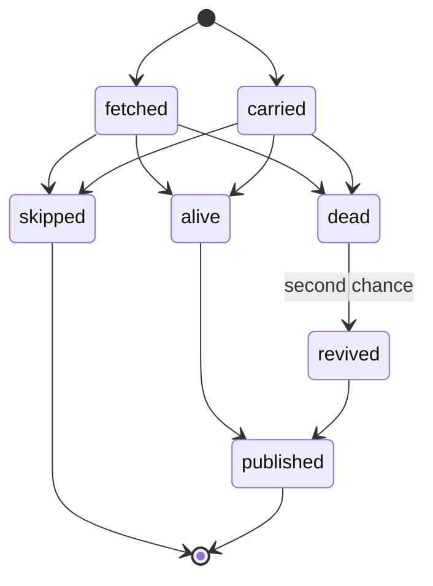
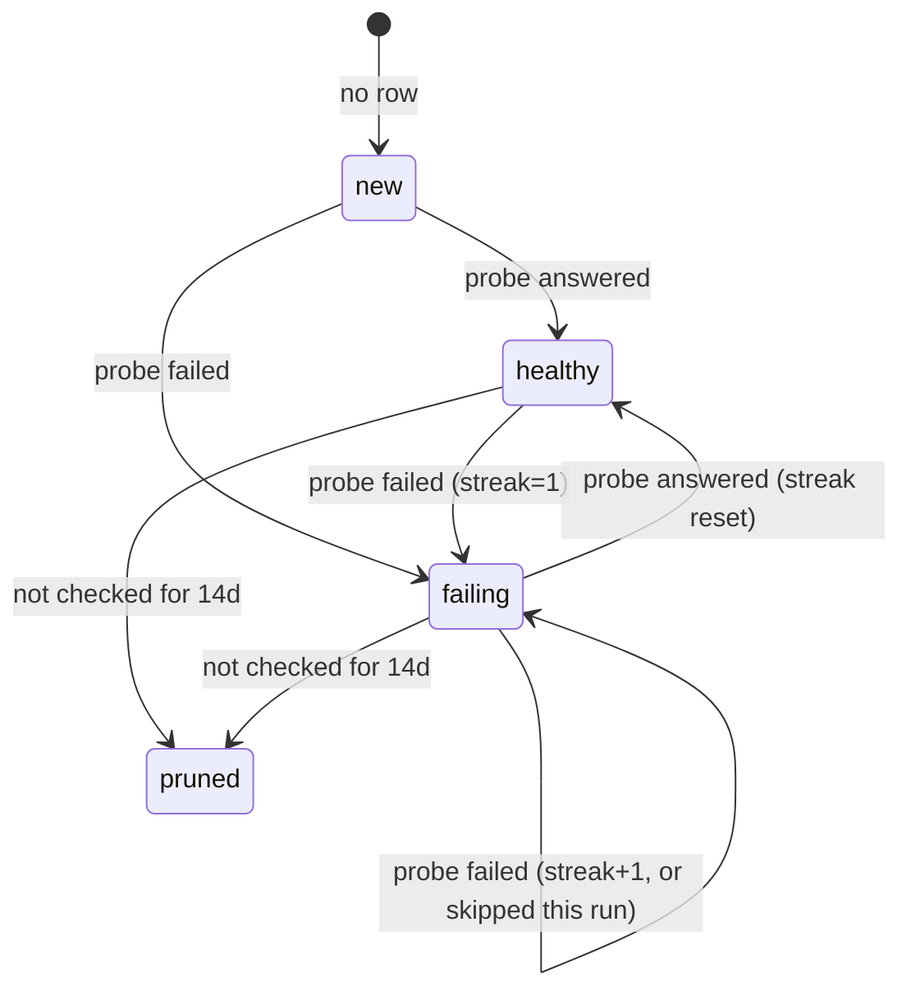

# Implicit state machines

A state machine is implicit when its states exist only as combinations of flags,
nullable fields and early returns, and each call site infers the ones it needs.
This repo has seven of them. They are listed here with the code that owns each
one, so the lifecycle can be read in one place instead of reconstructed from
`pipeline`, `check` and `history` at once.

One of them — the per-run record lifecycle — is now executable in
[`internal/lifecycle`](internal/lifecycle/lifecycle.go): it is what prints the
`lifecycle:` summary line and what asserts the run's counts balance. The rest
are documented only, on purpose: their transitions are entangled with I/O
(duckdb rows, HTTP retries, GitHub Actions), and renaming them in code would
change behavior without making them any easier to reason about. This file is the
contract they currently satisfy.

| machine | lives in | states | explicit? |
|---|---|---|---|
| 1. record lifecycle | `internal/pipeline`, `internal/check`, `internal/history` | fetched, carried, skipped, alive, revived, dead, published | yes |
| 2. probe / history row | `internal/history`, `internal/check/pool.go` | new, healthy, failing(n), recheck-due, skipped, pruned | no |
| 3. source fetch job | `internal/fetch/pool.go` | queued, inflight, cooling (429), done | no |
| 4. source walk | `internal/fetch/source.go` | entry, prefetching, paging, done | no |
| 5. upstream input | `internal/reputation`, `internal/geoip`, `internal/uagen` | fresh, stale-cache, absent | no |
| 6. history database | `internal/history/duckdb.go` | absent, empty, wrong schema, current | no |
| 7. run + publish | `internal/pipeline/run.go`, `.github/workflows/fetch.yml` | running, complete, partial; due, backed-off | no |

## 1. Record lifecycle (explicit)

One record (`ip:port`) in one run. Entry is either a source's report this run or
a carry-over from the previous `proxies.json`.



| transition | when |
|---|---|
| fetched/carried → skipped | history suppressed every claimed probe |
| fetched/carried → alive | at least one claimed protocol answered |
| fetched/carried → dead | every probe ran, none answered |
| dead → revived | the second-chance re-probe answered |
| alive/revived → published | kept by the checker, written to `proxies.json` |
| skipped → end | absent from the output, **history row untouched** |
| dead → end | absent from the output, **outcome recorded in history** |

The distinction between skipped and dead is the one users hit: both proxies are
missing from the published list. A skipped record was not actually retested
(recent failure streak, under the 24 h recheck floor), keeps its history, and can
return next run. A dead record was retested and failed; its failure streak grows
and its history row is pruned 14 days later.

Invariant, enforced by `lifecycle.Counts.Check` and logged as a warning when it
breaks:

```
fetched + carried == skipped + dead + published
```

`alive + revived == published` is why alive and revived are not in the sum: they
would count the same record twice. With `-skip-check`, skipped and dead are zero
and every record is published, which satisfies the same equation.

Published counts only fresh and carried records that survived; carried records
are excluded from the README's per-source table, so a source's numbers are never
inflated by its own republished output.

## 2. Probe and history row

Keyed `(ip, port, proto)` in `proxy_state`. This is the machine that decides
whether a probe runs at all, and the only one that persists across runs.



- **new**: no row, so nothing to skip and no second chance.
- **healthy**: `fails_streak = 0`. Skipped only if a failure streak exists, so a
  healthy protocol is probed every run.
- **failing(n)**: `fails_streak = n`. Each run, before the 24 h recheck floor,
  the probe is skipped with probability `0.15 + 0.75·(n-1)/23` — 15 % after one
  failure, 90 % at 24. Never skipped once `last_checked_ts` is 24 h old, so every
  row gets a real retest at least daily.
- **second chance**: a record whose every probe failed, but which has ever
  answered on any protocol (`last_ok_ts` set), is retried once as a whole record.
  The retry moves only the run's result; it does not double-count history.
- **scored**: `rel_ema` and `rt_ema` are folded in with `1/n` warm-up until
  n = 85 checks, then the fixed 168-check window. `rt_ema` only updates on a
  measured success; a timeout leaves the prior estimate alone.
- **pruned**: rows not checked within 14 days are deleted at the end of every run
  that opens history.

A record with every probe skipped is not in the output, and no outcome is written
for it — which is exactly why its state survives and why it can reappear.

## 3. Source fetch job

`internal/fetch/pool.go` schedules ~150 sources across two pools (wide, and
three-wide for `raw.githubusercontent.com`), one job per source.

| state | representation | leaves when |
|---|---|---|
| queued | `pending` entry with zero `notBefore` | a worker slot is free |
| cooling | `pending` entry with `notBefore = now+20s`, `attempts` up to 2 | cooldown expires; requeued at the tail |
| inflight | goroutine in `work`, `inflight` counter | completion on the channel |
| done | `sched.res[name]` set | terminal |

Rules encoded implicitly and worth keeping:

- a source that answers 429 goes back on the queue and gives up its slot for the
  whole cooldown, which is why the pool width is not an errgroup limit;
- dispatch is head-of-line only, so a cooling source at the front blocks what is
  behind it (benign: requeues are appended in completion order);
- the watchdog names a source every 8 s while it is in `states` and not yet in
  `res`, including during a requeue cooldown, because `Start` is not called again
  until the next attempt actually runs;
- a panic inside a source becomes that source's error, never the run's;
- when the context ends, cooldowns are zeroed so the remaining sources fail fast
  and are recorded instead of the pool spinning until they expire.

## 4. Source walk (prefetch + pagination)

`Fetcher.Source` is a second machine nested inside machine 3, per configured
source.

1. **prefetch** (optional): a chain of steps, each fetching a URL and extracting
   one value with `json_path` or `regex`; the value becomes a header, the next
   step's URL, or both. Only the last step's `as_url` decides whether the walk
   continues at the discovered URL or the configured one.
2. **entry**: a source is a list of URLs (or one implicit entry). A `urls[]`
   entry is paged only when its own template contains `{page}`/`{offset}`; a
   single-URL source is paged whenever pagination is configured. That is what
   lets one source scrape numbered list pages and fixed detail pages in the same
   walk.
3. **page**: fetch → parse → append. The pages continue until one of: the
   configured `max_pages`, a page that parses to zero records, a fetch/parse
   error, the source budget, or the server's own `total`/`pages` count on the
   first page (`total_path` can raise the cap, `pages_path` only lowers it).
4. **fallback**: only for an unpaged first entry, and only the last candidate's
   error is reported, so a source that succeeds via `fallback_url` looks clean.

## 5. Upstream input availability

Three different fallback policies, chosen per input because their freshness
requirements differ:

| input | fresh | stale allowed | absent |
|---|---|---|---|
| reputation feeds | always re-downloaded | yes, cached file if download fails | both feeds empty → warn, run without `reputation` block |
| geoip/asn snapshots | cache hit is enough (monthly upstream) | no — current month then previous month, else error | check phase aborts |
| uagen inputs | fetched every run, 3 min cap | no | warn, that browser family drops out, run continues |

The asymmetry is deliberate: publishing proxies without reputation is fine;
publishing without country/asn would silently change the output schema's
meaning; publishing user agents without one browser family is still useful.

## 6. History database

`history.duckdb` is derived data, so every recovery path rebuilds rather than
migrates:

```
absent ──> create schema, version 4
zero-byte ──> delete, then create           (workflow's 404 leaves one behind)
version != 4 ──> drop proxy_state, recreate, set version
version == 4 ──> CREATE TABLE IF NOT EXISTS
```

Rows are folded in set-based: append into a temporary staging table, `DELETE`
the keys it supersedes, then `INSERT ... QUALIFY row_number() ... ORDER BY seq
DESC` so the last outcome for a key wins. This is why the schema carries no
primary key (the ART index alone was 122 MB of a 139 MB file).

## 7. Run and publish

Two coupled machines outside the Go process's state.

**Run**: the `.complete` marker in `output/` is removed before any work (unless
`-dry-run`) and rewritten only after every output is on disk. The workflow's
commit and publish steps run `if: always()` but bail out when the marker is
missing, so a failed or timed-out run publishes nothing rather than a partial
`proxies.json` or a half-written history file. The check phase is the only phase
with a deadline (the 90 min budget); everything after it is undeadlined, which is
why the job timeout is 180 min and the step timeout 120 min.

**Cadence guard**: the scheduled workflow fires every 5 minutes and the guard job
decides whether a run is due.

| observation | decision |
|---|---|
| manual dispatch, not gated | due |
| an active run with a lower run id | back off |
| an active run older than 200 min | cancel it, then continue |
| no `output` branch yet | due |
| last publish ≥ 35 min old | due |
| otherwise | back off |

## Not machines

Worth naming so they are not mistaken for missing state models:

- **anonymity** (`"" → transparent → anonymous → elite`) is a lattice, used only
  to pick the strongest claim during merge.
- **ip_type** (hosting/residential/…) and **country** are classifications, not
  transitions.
- **quality** is a pure function of reliability, speed and reputation, recomputed
  every run rather than carried as state.

## Where to look

- `internal/lifecycle/lifecycle.go` — the record lifecycle, transitions, counts,
  and the balance invariant (machine 1).
- `internal/history/duckdb.go` — `nextState`, `SkipKeys`, `AliveMap`, `Prune`
  (machine 2).
- `internal/check/pool.go` — `CheckAll`'s skip filter, second chance and budget
  cut (machines 1 and 2).
- `internal/fetch/pool.go` — `pool`, `collect`, `watch` (machine 3).
- `internal/fetch/source.go` — `Source`, `prefetch` (machine 4).
- `internal/reputation/reputation.go`, `internal/geoip/download.go`,
  `internal/uagen/uagen.go` (machine 5).
- `internal/pipeline/run.go` and `.github/workflows/fetch.yml` (machines 1 and 7).
